# video-strm 用户手册

> 扫描 OpenList 云端目录，为视频生成 `.strm` 下载链接并下载字幕的任务调度工具（本地部署）。
> 本文档按功能模块介绍使用方式。

---

## 目录

1. [快速部署](#一快速部署)
2. [全局配置](#二全局配置)
3. [服务器配置](#三服务器配置)
4. [任务配置](#四任务配置)
5. [执行管理](#五执行管理)
6. [实时日志](#六实时日志)
7. [任务历史](#七任务历史)
8. [界面主题](#八界面主题)
9. [常见问题](#九常见问题)
10. [升级与备份](#十升级与备份)
11. [设置（桌面版）](#十一设置桌面版)

---

## 一、快速部署

使用已发布的 Docker 镜像，无需安装 Python / Node。

### 1. 准备 docker-compose.yml

创建部署目录并新建 `docker-compose.yml`（也可直接复制仓库内的 `docker-compose.example.yml`，或参考 [README 快速部署](https://github.com/yyc001207/video-strm#快速部署开箱即用)）：

```yaml
services:
  video-strm:
    image: yyc001207/video-strm:latest
    container_name: video-strm
    restart: unless-stopped
    ports:
      - "8000:8000"
    volumes:
      - ./data:/app/data                 # SQLite 数据库
      - ./openlist_logs:/app/openlist_logs  # 执行日志
      - ./output:/app/output             # STRM/字幕输出目录
    environment:
      - TZ=Asia/Shanghai
```

三个目录的作用：

| 主机目录 | 容器目录 | 说明 |
|----------|----------|------|
| `./data` | `/app/data` | SQLite 数据库（任务/服务器等配置） |
| `./openlist_logs` | `/app/openlist_logs` | 每次执行的日志文件 |
| `./output` | `/app/output` | STRM/字幕输出目录，任务输出目录以 `/` 开头（如 `/emby/电视剧`）时生成到 `/app/output/emby/电视剧` |

### 2. 启动

```bash
docker compose up -d
```

启动后访问 `http://127.0.0.1:8000` 即进入系统首页（五页签：全局配置 / 任务配置 / 执行管理 / 任务历史 / 实时日志）。

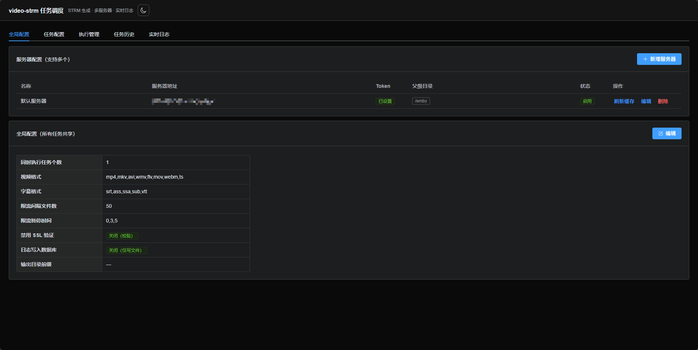

> **首次使用**：系统默认不预置任何服务器，请先进入「全局配置」添加你的 OpenList 服务器（地址 + Token + 父级目录），再创建任务执行。

### 3. Windows 安装包（可选）

不想装 Docker 时，可直接使用 Windows x64 安装包：推送 `v*` 标签后 CI 会自动构建并发布到 GitHub Releases，也可按 [README「Windows 安装包」](https://github.com/yyc001207/video-strm#windows-安装包exe) 自行构建。

- **安装**：双击 `video-strm-<版本>-win-x64-setup.exe`，按向导下一步即可，无需管理员权限（安装到当前用户目录）。
- **启动**：双击开始菜单或桌面快捷方式，直接弹出应用窗口（原生 WebView2 窗口，**不经过浏览器、没有黑色命令行窗口**）。
- **关闭与退出**：点窗口关闭按钮（×）只是**收进系统托盘**，复制/下载任务继续在后台跑；要彻底退出，右键托盘图标选「退出」。
- **托盘菜单**：`打开主界面` / `设置…`（直接跳到设置页）/ `快捷设置`（勾选开机自启、启动时最小化、关窗收进托盘，改完立即生效）/ `打开数据目录` / `退出`。
- **端口**：默认 `8000`，被占用时自动顺延到 `8001`、`8002`…，窗口按实际端口加载。
- **数据位置**：`%LOCALAPPDATA%\video-strm` 下的 `data`（数据库）、`openlist_logs`（执行日志）、`output`（STRM/字幕）、`logs`（程序日志 `app.log`）。卸载程序**不会**删除该目录，重装后配置与文件都在。
- **重复启动**：已有一个窗口在运行时，再次双击 exe/快捷方式会**把已有窗口唤到前台**，不会启动第二个服务或产生两套数据；若上个进程正在退出，会自动等它结束后再启动。
- **环境要求**：Windows 10/11 一般自带 WebView2 运行时；若提示缺失，安装 [Microsoft Edge WebView2 Runtime](https://developer.microsoft.com/microsoft-edge/webview2/) 即可。

---

## 二、全局配置

「全局配置」页签包含两块：**服务器配置**（见下一节）与**全局配置**（所有任务共享的参数）。

点击「编辑」可修改：

| 配置项 | 说明 |
|--------|------|
| 同时执行任务个数 | 限制同时运行的任务数量，超出排队等待 |
| 视频格式 | 识别为视频的扩展名（逗号分隔，如 `mp4,mkv,avi`） |
| 字幕格式 | 识别为字幕的扩展名（逗号分隔） |
| 限流间隔文件数 | 每隔 N 个文件暂停一次（对服务器限流） |
| 限流暂停时间 | 暂停秒数，逗号分隔随机取一；填 `0` 不限流 |
| 输出目录前缀 | 快速添加任务配置时拼接到输出目录前（默认空） |
| 输出根目录 | 任务输出目录以 `/` 开头时相对此目录生成。默认空 = 程序目录下的 `output`（Docker 为 `/app/output`）；桌面版可填媒体库绝对路径（如 `D:\Media\strm`），也可点「选择」直接唤起系统文件夹选择框 |
| 禁用 SSL 验证 | 内网自签名 HTTPS 时开启 |
| 日志写入数据库 | 开启后日志双写数据库（默认仅写日志文件） |

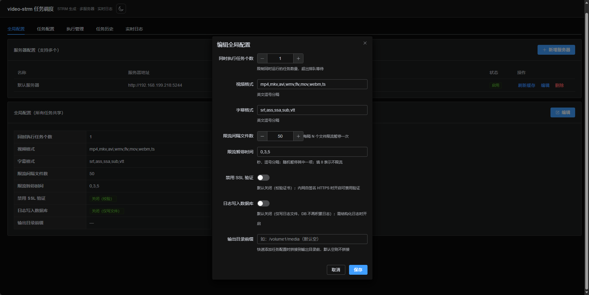

---

## 三、服务器配置

「全局配置」页签上半部分为**服务器配置**，支持多台 OpenList 服务器。

### 新增/编辑服务器

点击「新增服务器」，填写：

- **名称**：可选，便于识别
- **服务器地址**：OpenList/AList API 地址（如 `http://192.168.1.100:5244`）
- **访问 Token**：OpenList 的访问令牌
- **父级目录**：每行一个，**无需手写 `/`**（如 `emby/动漫` 自动存为 `/emby/动漫`）；可配置多个
- **跳过校验**：服务器暂时不可达时可跳过存在性/读写校验（格式校验始终执行）

**保存时自动校验**每个父级目录：路径格式 → 目录是否存在 → 是否具备读写权限；任一失败会阻止保存并提示具体原因。

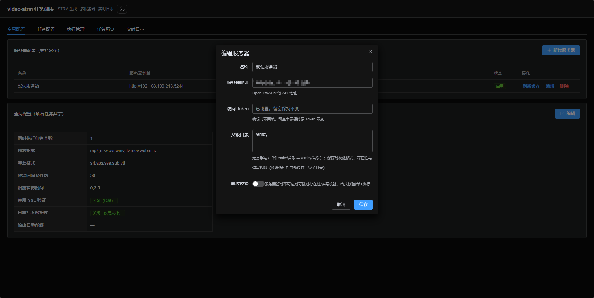

### 目录缓存与刷新

- 校验通过后，系统自动缓存每个父级目录的一级子目录（条目含名称/路径/最后修改时间），执行管理/快速添加时缓存优先、减少服务器请求
- 每台服务器行尾的 **「刷新缓存」** 按钮：手动刷新该服务器全部父级目录的一级缓存


---

## 四、任务配置

「任务配置」页签管理所有任务。**任务强关联服务器**：每个任务必须属于某一台服务器，表格展示服务器地址，并可按服务器筛选。

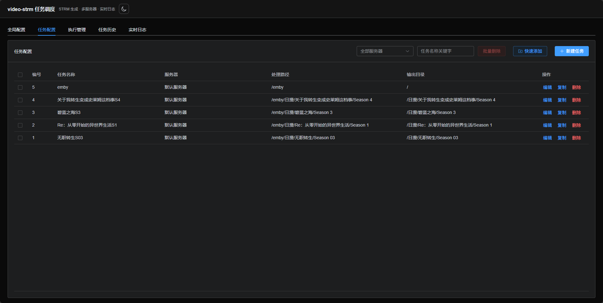

### 手动新建/编辑任务

点击「新建任务」（或行内「编辑」/「复制」），填写：

- **所属服务器**（必选）：任务只能在所属服务器上执行
- **任务名称**
- **处理路径**：云端目录路径（如 `/emby/动漫/日漫`）
- **输出目录**：STRM/字幕落盘目录。以 `/` 开头时相对「全局配置 → 输出根目录」解析（未配置则用程序目录下的 `output`）；也可直接填绝对路径（如 `D:\Media\strm\电视剧`）
- **限流间隔 / 限流暂停**：可留空，留空则使用全局配置

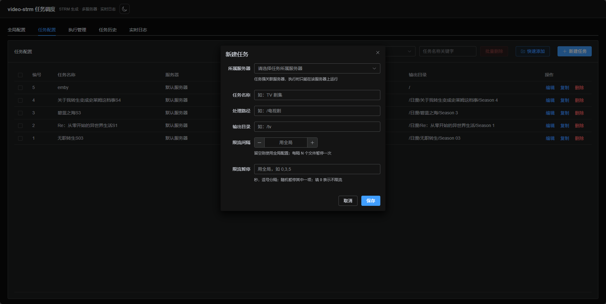

### 快速添加（按目录批量生成）

点击「快速添加」，在右侧抽屉中：

1. **选择服务器** → 自动带出其父级目录
2. **父级目录**：下拉选择；没有想要的父级目录可点 **「新增」** 直接添加（校验后自动缓存并选中）
3. **目录树**：从父级目录开始逐层展开勾选目录（可多选、任意层级单独勾选）
4. **搜索**：输入关键字模糊搜索**已加载的缓存目录**；结果项可点 **「进入」** 继续下钻浏览其子目录并选择
5. **「刷新缓存」**：递归刷新当前父级目录下**所有层级**的目录缓存
6. 选项：
   - **同时把父级目录本身作为一条任务配置**（其输出目录为 `/`，表示父级作为根）
   - **输出目录带父级目录**：选中以父级目录开头（如 `/emby/电视剧`），不选以一级子目录开头（如 `/电视剧`）
   - **限流间隔 / 限流暂停**：可留空用全局
7. **添加预览**：确认每条任务（任务名/处理路径/输出目录），可单独 **删除**（同步取消树勾选）
8. 点击 **「添加 N 条任务配置」** 批量创建

> 季文件夹（`Season 01` / `S01` / `Season 1` 等）自动命名为「上级文件夹名S季号」，如 `美剧/Season 01` → 任务名 `美剧S01`。

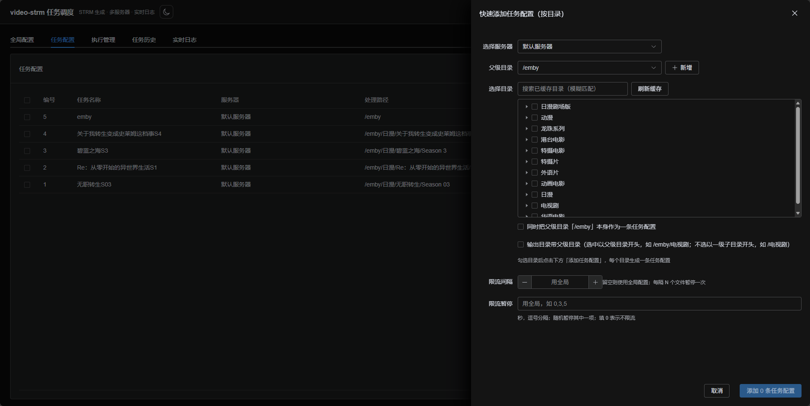
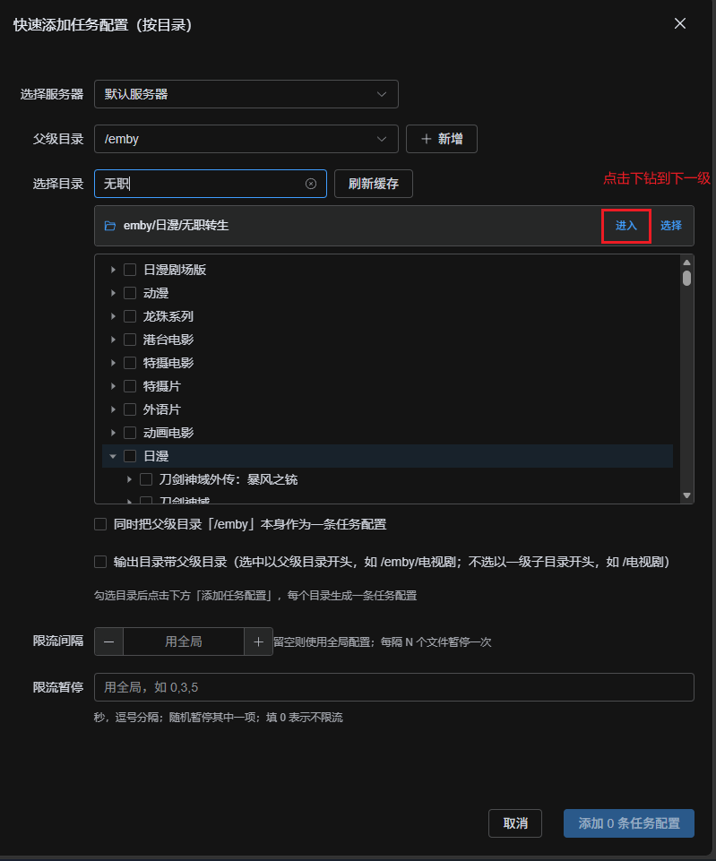
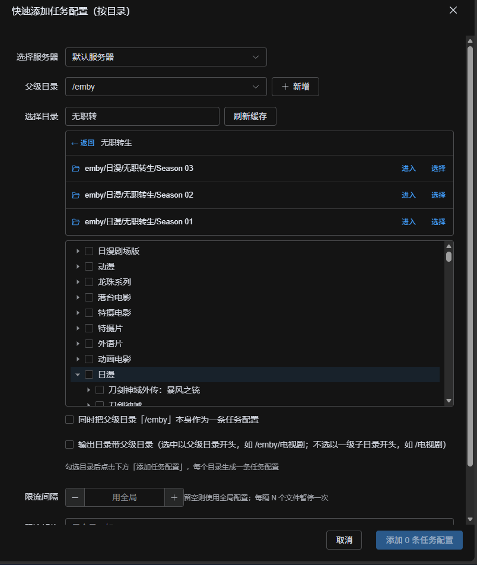
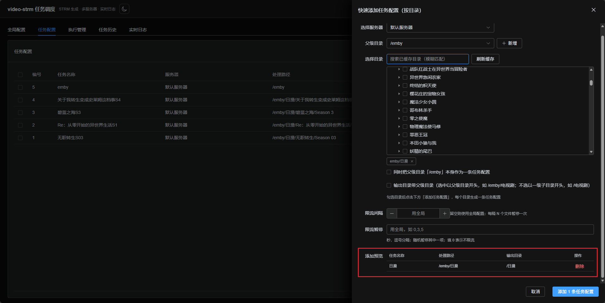

---

## 五、执行管理

「执行管理」页签用于批量执行任务。

1. **选择服务器**：下拉选择（只列启用中的服务器）
2. **选择任务**：**仅展示所选服务器的任务**（强关联），可多选、关键字过滤，运行中的任务置灰
3. 执行选项：
   - **增量更新**：默认开启，跳过已存在的 STRM/字幕
   - **强制生成**：开启后重新生成全部；可再勾选 **仅更新 strm**（不重下已存在字幕）
   - **系列层优化**：默认关闭，详见下方说明
4. 点击 **「执行任务」** → 自动跳转「实时日志」页
5. **取消任务**：选中正在执行的任务后可取消

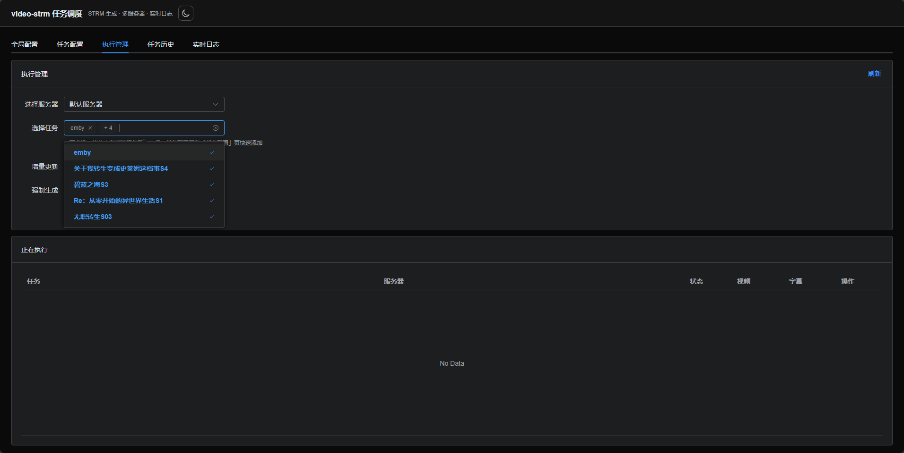

### 系列层优化（可选，默认关闭）

用于电影合集类目录（如「哆啦A梦系列」），让输出目录不再多出一层「系列」文件夹。

**规则**

- **仅当路径中存在名称含「电影」的目录层时才生效**；名称不含「电影」的目录一律按原始结构输出
- 移除该「电影」目录层**之下**所有名称含「系列」的目录层，其余层级结构保持不变
- **strm 文件内的下载链接始终保留原始完整云端路径**，不受该规则影响

**示例**

| | 路径 |
|---|---|
| 云端原始文件 | `/动画电影/哆啦A梦系列/哆啦A梦：大雄的宇宙小战争2021/xxx.mp4` |
| 输出目录（开启优化） | `/动画电影/哆啦A梦：大雄的宇宙小战争2021/xxx.mp4` |
| 输出目录（关闭优化，默认） | `/动画电影/哆啦A梦系列/哆啦A梦：大雄的宇宙小战争2021/xxx.mp4` |
| strm 内链接（两种情况一致） | `.../d/动画电影/哆啦A梦系列/哆啦A梦：大雄的宇宙小战争2021/xxx.mp4` |

**注意事项**

1. **开启/关闭会产生不同的目录结构**：切换开关不会自动搬迁已生成的文件（也不会删除它们），首次开启前建议先清空输出目录，避免新旧结构并存
2. **失效清理保护**：开启优化后，目录失效判定按「本地相对路径」进行，并同时登记**未优化（旧结构）**与**优化后（新结构）**两种层级，因此「系列」层之下的已生成目录、以及开关切换前遗留的旧结构都不会被误删；只有云端确实已不存在的文件/目录才会被清理。此外，若某个目录扫描失败（网络异常等），该目录**及其所有上级目录**的失效清理会整体跳过，宁可残留也不误删
3. 开关状态随每次执行记录保存，可在「任务历史」详情中查看本次执行是否启用了优化


---

## 六、实时日志

执行后自动进入「实时日志」页，WebSocket 实时推送日志与进度：

- 多任务批量执行时，顶部下拉可**切换查看**各任务的日志
- 展示视频/字幕处理进度（成功/总数）
- 任务完成后可前往「任务历史」查看回放与下载

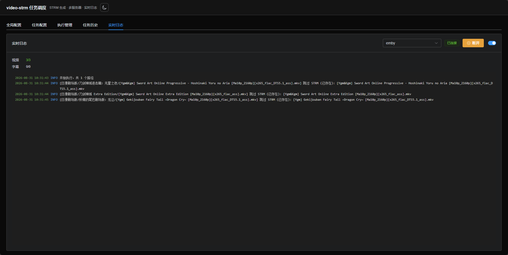

---

## 七、任务历史

「任务历史」页签：

- **列表**：每个任务最近一次执行，可按**服务器筛选**；展示任务名称、处理路径、服务器、状态、视频/字幕数、耗时、执行时间
- **详情页**：点击任务名或「详情」进入**独立页面**，展示该任务全部执行记录（处理路径/输出目录/状态/进度/耗时），支持分页
- 每条记录可 **查看日志**（回放）与 **下载日志文件**

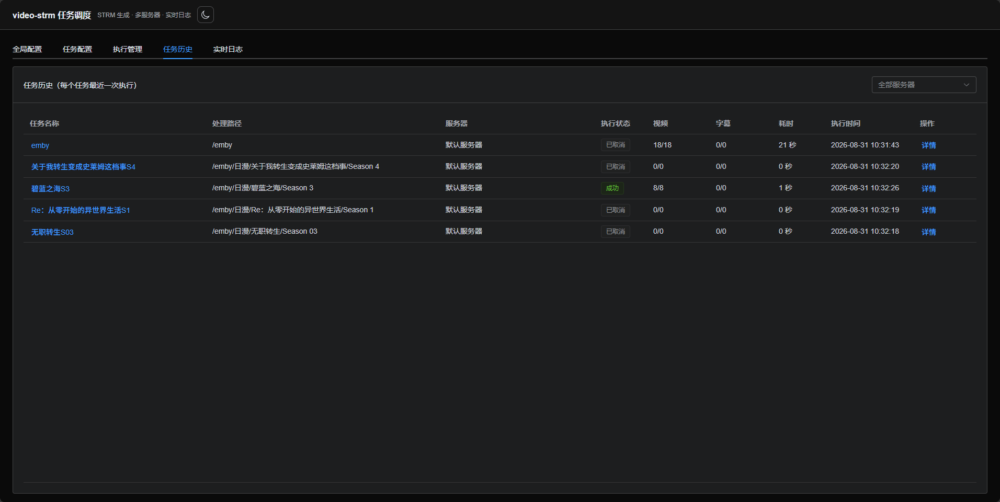
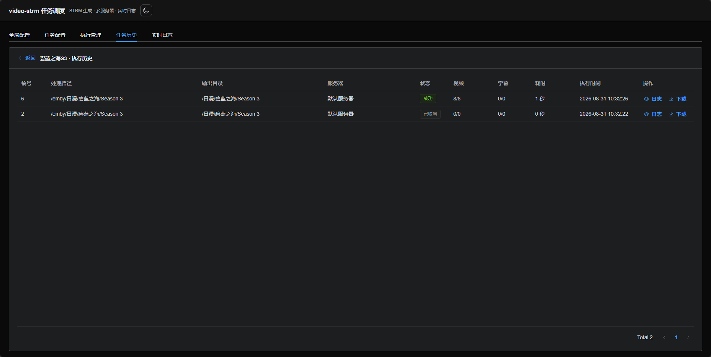
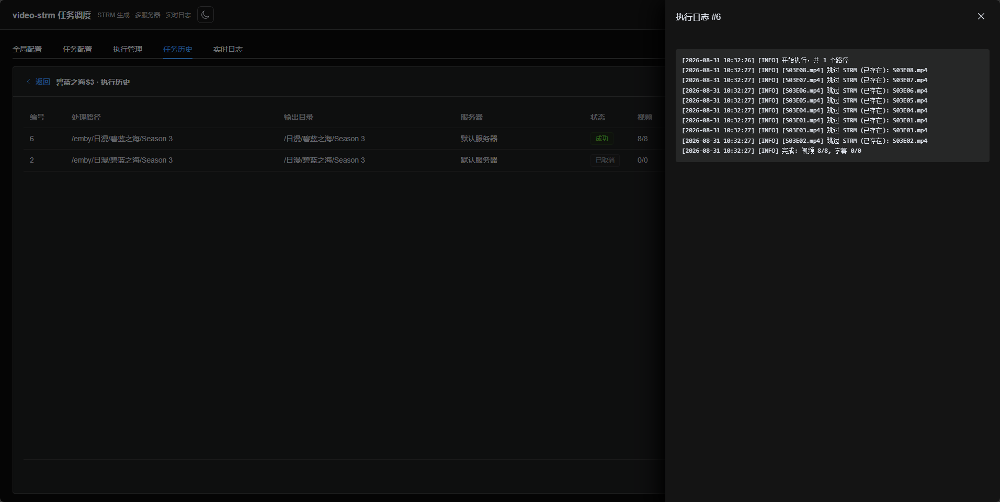

---

## 八、界面主题

右上角主题按钮支持 **浅色 / 深色 / 跟随系统** 三种模式，选择自动记忆（localStorage），刷新不闪白。

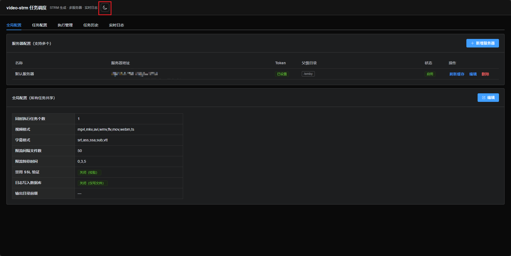

---

## 九、常见问题

| 问题 | 处理 |
|------|------|
| 添加服务器提示「目录校验失败」 | 检查父级目录是否真实存在、Token 是否有权限；服务器不可达时可勾选「跳过校验」保存 |
| 执行提示「任务与所选服务器不匹配」 | 任务强关联服务器，请切换到任务所属服务器执行 |
| 快速添加没有目录展示 | 确认服务器已配置父级目录；未配置可在快速添加里点「新增」添加 |
| 搜索不到目录 | 搜索范围是**已加载（已缓存）**的目录：先在目录树展开对应层级，或点「刷新缓存」后再搜 |
| 开启「系列层优化」后目录结构没变化 | 该规则仅在路径中存在名称含**「电影」**的目录、且其下有名称含**「系列」**的目录时生效；否则按原始结构输出 |
| 开启优化后旧文件/目录仍然存在 | 切换开关不会自动搬迁或删除旧结构文件（安全设计），首次开启前建议先清空输出目录 |
| 开启优化后，「系列」目录下的文件夹会被当作失效目录删除吗 | 不会。失效清理按本地相对路径判定，并同时登记优化前后的两种结构，系列层之下的已生成目录和旧结构都会被保留；只有云端确实已不存在的条目才会被清理 |
| 生成的文件属主是 root | 容器以 root 运行，映射目录内文件属主为 uid 0，与媒体库共用目录时注意权限 |
| 端口被占用 | Docker 部署：修改 docker-compose 的 `ports` 映射并重启；Windows 安装包：自动顺延到下一个可用端口，看控制台日志里的实际地址 |

---

## 十、升级与备份

**升级**

```bash
docker compose pull && docker compose up -d
```

**备份**（数据都在映射目录中）

```bash
# 停容器后备份（或直接复制）
tar -czf video-strm-backup.tar.gz data openlist_logs
```

---

## 十一、设置（桌面版）

点击右上角「设置」进入独立页面（页面左上角「返回」可回到任务调度），集中管理桌面客户端的行为；网页版（Docker）只读展示。

| 设置项 | 说明 |
|--------|------|
| 开机自动启动 | 写入 `HKCU\Software\Microsoft\Windows\CurrentVersion\Run`，登录 Windows 后自动在后台启动；卸载时会自动清理该项 |
| 启动时最小化到托盘 | 双击启动后不弹窗口，只在系统托盘常驻；左键托盘图标可打开主界面。**重启应用后生效** |
| 关闭窗口时最小化到托盘 | 点 × 只收进托盘、任务继续跑；关闭后需从托盘菜单「退出」才结束进程。**改完立即生效**（托盘「快捷设置」里也能切换） |
| 托盘图标显示 | Windows 11 会把新图标默认折叠进任务栏「^」，该行为由系统控制；「固定到任务栏」写入常驻显示标记（重启资源管理器或下次登录后生效），「任务栏设置」可直接打开系统页面手动开启 |
| 打开数据目录 | 在资源管理器中打开 `%LOCALAPPDATA%\video-strm` |
| 数据与日志 | 展示数据目录、日志文件（`logs/app.log`）与程序路径 |
| 关于 | 版本号与运行模式（Windows 桌面版 / 网页版） |

> 托盘图标默认折叠在任务栏右下角「^」里，可拖动到常驻区；`VIDEO_STRM_TRAY=0` 可整体关闭托盘（关窗即退出）。

- `data/`：SQLite 数据库（服务器/任务/执行记录等全部配置与历史）
- `openlist_logs/`：执行日志文件
- `output/`：生成的 STRM/字幕文件
