# up-video-strm 用户手册

**up-video-strm** 是一款面向 OpenList / AList 的任务调度工具：扫描云端目录，把视频生成 `.strm` 链接文件并下载字幕，交给 Emby / Jellyfin 等媒体库扫描播放。

本手册面向使用者，按功能模块说明安装、配置与日常操作。工程实现与开发说明见 [docs/rules/](../docs/rules/) 目录。

## 目录

1. [安装（Windows 安装包）](#1-安装windows-安装包)
2. [启动与托盘](#2-启动与托盘)
3. [全局配置](#3-全局配置)
4. [服务器配置](#4-服务器配置)
5. [任务配置](#5-任务配置)
6. [执行管理](#6-执行管理)
7. [实时日志](#7-实时日志)
8. [任务历史](#8-任务历史)
9. [界面主题](#9-界面主题)
10. [桌面设置](#10-桌面设置)
11. [升级与备份](#11-升级与备份)
12. [旧版本数据兼容](#12-旧版本数据兼容)
13. [常见问题](#13-常见问题)
14. [数据目录与环境变量](#14-数据目录与环境变量)

---

## 1. 安装（Windows 安装包）

### 系统要求

- Windows 10 / 11，64 位
- Microsoft Edge WebView2 运行时（Win10/11 一般已自带；缺失时安装程序与启动都会提示，按提示安装即可）

### 安装步骤

1. 获取安装包 `up-video-strm-<版本>-win-x64-setup.exe`。
2. 双击运行，按向导点击下一步。
3. 安装过程**不需要管理员权限**，程序按当前用户安装到 `%LOCALAPPDATA%\Programs\up-video-strm`。
4. 可选任务：
   - 「创建桌面快捷方式」（默认不勾选）
   - 「开机自动启动」（默认不勾选，也可安装后在「设置」页修改）
5. 安装完成后可直接勾选「立即运行」。

安装程序会检测 WebView2 是否可用，缺失时弹窗提示，安装后重新启动应用即可。

### 升级与卸载

- 安装包使用固定 AppId，属于同一产品的升级：**升级时先卸载旧版本，再安装新版本**；卸载不会删除数据目录，重装后配置与已生成的输出文件都会保留。
- 卸载时会清理开机自启注册表项（当前用户级，旧版本遗留的自启项也会一并清理）。
- 数据目录默认保留，如需彻底清除请手动删除 `%LOCALAPPDATA%\up-video-strm`。

> 从早期版本升级到本版本的兼容规则见 [旧版本数据兼容](#12-旧版本数据兼容)。

---

## 2. 启动与托盘

### 启动

从开始菜单或桌面快捷方式启动 `up-video-strm`：

- 直接弹出**原生窗口**（WebView2 内核），不经过浏览器，也没有黑色控制台窗口。
- 首次启动会自动创建数据目录、SQLite 数据库并写入默认全局配置。
- 默认只监听本机地址 `127.0.0.1:8000`；端口被占用时自动顺延（见下文「端口与日志」）。

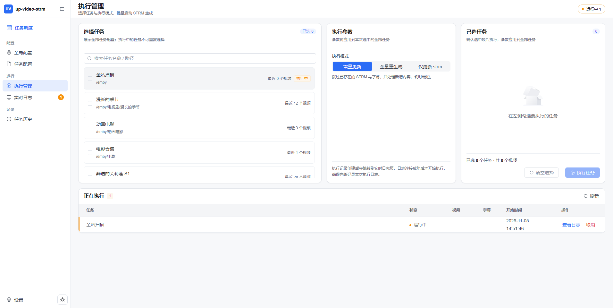

### 系统托盘

关闭窗口不会退出程序，而是**收进系统托盘**继续在后台运行：

- 单击托盘图标 → 打开主界面（默认菜单项）
- 「设置…」→ 直接跳到设置页
- 「快捷设置」→ 开机自动启动 / 启动时最小化到托盘 / 关闭窗口时最小化到托盘
- 「打开数据目录」→ 资源管理器中打开 `%LOCALAPPDATA%\up-video-strm`
- 「退出」→ 真正结束程序

Windows 11 默认会把新图标折叠进托盘溢出区。若看不到图标，可：

- 将托盘图标拖到任务栏常驻区，或在「任务栏设置」中调整；
- 在「设置」页点击「托盘图标不显示？」→ 跳转任务栏设置，或使用「修复托盘图标」将其重新置顶。

### 单实例

程序使用系统级互斥体保证只有一个实例。重复双击图标不会启动第二个实例，而是**唤起已在运行的窗口**。

### 端口与日志

- 首选端口 `8000`，被占用时依次尝试 `8001`、`8002`…（最多 20 个），找到可用端口后窗口按实际端口加载。
- 启动日志写入 `%LOCALAPPDATA%\up-video-strm\logs\app.log`；超过 5 MB 会轮转为 `app.log.1`。
- 实例已运行时再次启动，会提示「up-video-strm 已在运行，已请求其显示窗口」。

### 排查服务模式

若窗口无法打开（例如 WebView2 异常），可设置环境变量 `UP_VIDEO_STRM_UI=server` 再启动，此时只运行后台服务、不弹窗口，用浏览器访问 `http://127.0.0.1:8000` 排查问题。

> 更多环境变量见 [数据目录与环境变量](#14-数据目录与环境变量)。

---

## 3. 全局配置

主界面启动后默认进入「任务调度 → 执行管理」。左侧为分组导航：**任务调度**模块下分「配置」（全局配置、任务配置）、「运行」（执行管理、实时日志）、「记录」（任务历史）；侧栏底部是「设置」与主题切换按钮，侧栏可折叠。顶部显示当前页面标题、说明与全局运行状态胶囊，点击状态胶囊可跳到「实时日志」（见 [桌面设置](#10-桌面设置)）。

「全局配置」页面左侧是**服务器配置**（见下一节），右侧是当前全局参数的摘要卡，点击「编辑配置」打开编辑弹窗：

| 配置项 | 说明 |
|--------|------|
| 同时执行任务个数 | 并发上限，`1` 表示逐个执行 |
| 视频格式 | 逗号分隔的扩展名列表（如 `mp4,mkv,avi`），命中才生成 `.strm` |
| 字幕格式 | 逗号分隔的字幕扩展名列表，命中才下载字幕；留空则不下载 |
| 限流间隔文件数 | 每处理多少个文件后暂停一次，`0` 表示不启用限流 |
| 限流暂停时间 | 暂停秒数，支持逗号分隔的正整数区间，每次随机取值；`0` 表示不限流 |
| 输出目录前缀 | 拼在所有输出路径前的固定前缀，默认留空 |
| 输出根目录 | `.strm` 与字幕的输出根目录，默认留空；留空时使用程序数据目录下的 `output` |
| 禁用 SSL 验证 | 连接自签名 HTTPS 的 OpenList/AList 时开启 |

- 输出根目录在桌面版可点击「选择」直接挑目录，也可填绝对路径；改动后新生成的文件按新目录输出。
- 右侧摘要卡以「名称 — 当前值」列表展示生效参数，点「编辑配置」打开右侧抽屉修改。
- 修改后点击保存生效。

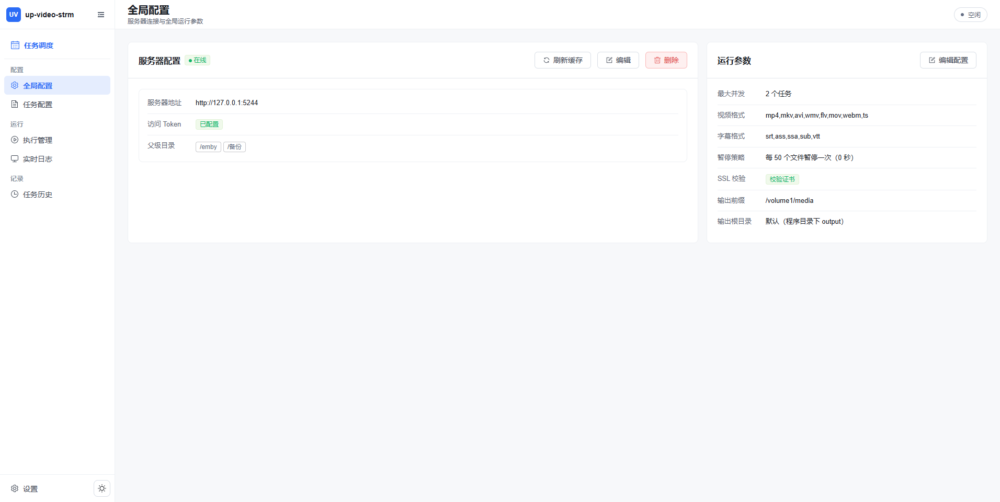

---

## 4. 服务器配置

「全局配置」页面左侧是**唯一的服务器卡片**，用于登记 OpenList / AList 服务器。系统只支持一台服务器：未配置时显示空态与「新增服务器」入口，配置后不再出现「新增服务器」按钮。

### 新增服务器

点击「新增服务器」填写：

| 字段 | 说明 |
|------|------|
| 服务器地址 | 带协议与端口的完整地址，如 `http://192.168.1.10:5244` |
| 访问 Token | OpenList/AList 的 API Token，用于调用接口 |
| 父级目录 | 允许添加任务的根目录，**每行一个**；输入时会自动补全开头的 `/` |
| 跳过目录校验 | 勾选后保存时不校验父级目录是否存在与可读写 |

保存时会依次校验：地址格式是否正确 → 父级目录是否存在 → 是否有读写权限。校验失败会提示具体原因，修正后重新保存；对确认存在但暂时无法访问的目录，可勾选「跳过目录校验」。

弹窗左下角的「测试连通性」按钮可在保存前单独验证地址与 Token：读取 OpenList 根目录成功即提示「连接成功」及根目录条目数，失败则提示具体原因（超时、地址不可达、Token 无效等）。编辑已有服务器时 Token 留空即可用已保存的 Token 测试；未配置 Token 的服务器会以匿名方式测试。

### 服务器卡片与缓存

- 卡片标题右侧显示当前服务器状态：在线（绿）、离线（红）、未配置（灰）、检测中（黄）；卡片内展示地址、Token 是否已配置，以及父级目录标签；可编辑、删除；右上角可「刷新缓存」。
- 保存成功后自动拉取父级目录的**一级子目录**并缓存（名称、路径、最后修改时间），供「快速添加」使用。
- 云端目录有变化时，点击「刷新缓存」重新拉取；缓存范围外的目录需要先在父级目录层级下显示出来才能勾选。
- 如需更换服务器，直接编辑当前服务器；删除后页面回到空态，可重新添加。

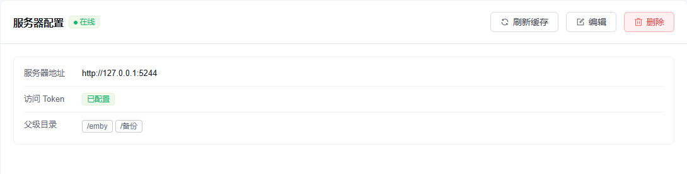

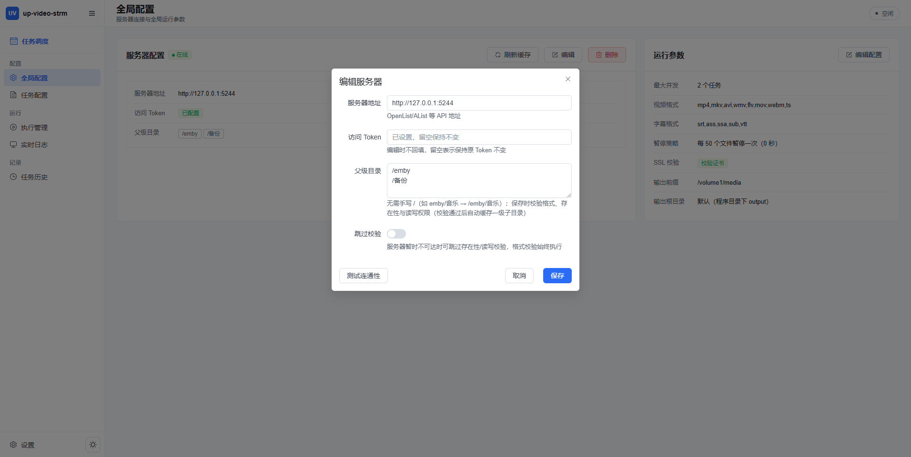

---

## 5. 任务配置

「任务配置」页面管理所有任务。系统只有一台服务器，新建/快速添加的任务会自动归属该服务器，列表不再区分服务器。

### 手动新建 / 编辑 / 复制

点击「新建任务」或行内「编辑」「复制」：

| 字段 | 说明 |
|------|------|
| 任务名称 | 便于识别的名称 |
| 处理路径 | 云端待扫描的目录路径 |
| 输出目录 | 以 `/` 开头时相对「输出根目录」解析，也可填绝对路径；可留空表示输出到输出根目录 |
| 限流间隔文件数与暂停时间 | 留空则沿用全局配置，填写则只对当前任务生效 |

### 快速添加

适合一次为多个目录创建任务：点击「快速添加」打开抽屉，按步骤操作：

1. **选择父级目录**：下拉可选当前服务器已配置的父级目录；没有合适的可点「新增」即时添加。
2. **勾选目录**：目录树按层级展开，逐层勾选要创建任务的目录；已缓存的目录支持关键字搜索，搜到后可点「进入」下钻到该目录。
3. **刷新缓存**：点「刷新缓存」可递归拉取当前目录的子目录（层级越深耗时越长）。
4. **选项**：
   - 「父级目录本身作为任务输出目录」：勾选后输出目录为 `/`（直接落在输出根目录下）；不勾选则按所选目录的层级生成输出目录。
   - 输出目录可选「带父级目录」或「从一级子目录开头」两种拼法。
   - 限流间隔与暂停时间留空则沿用全局配置。
5. **添加预览**：抽屉底部列出将要创建的任务配置，可逐条删除；确认后点「添加 N 条任务配置」批量创建。

快速添加生成的输出目录会依据目录名自动识别季信息：`Season 01`、`S01`、`Season 1` 等目录名会生成「上级目录名 + S + 季号」形式的名称，便于媒体库识别。

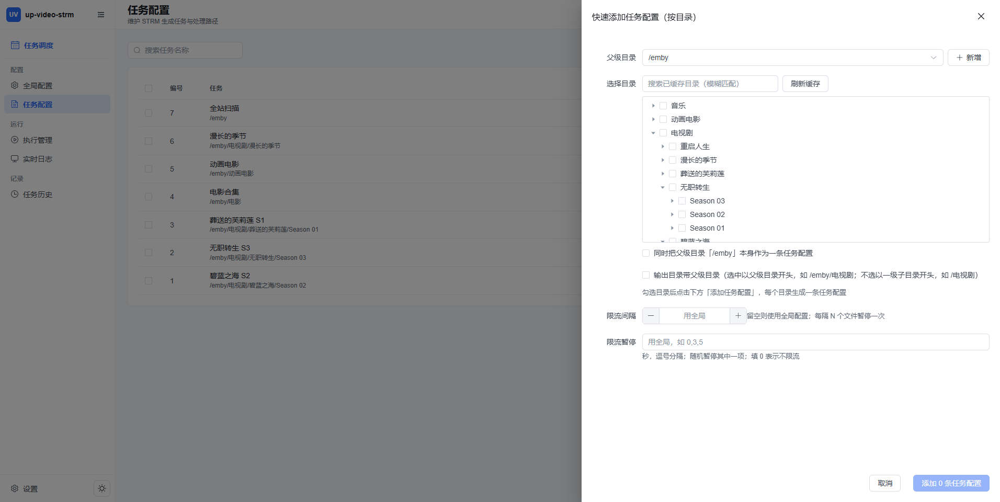

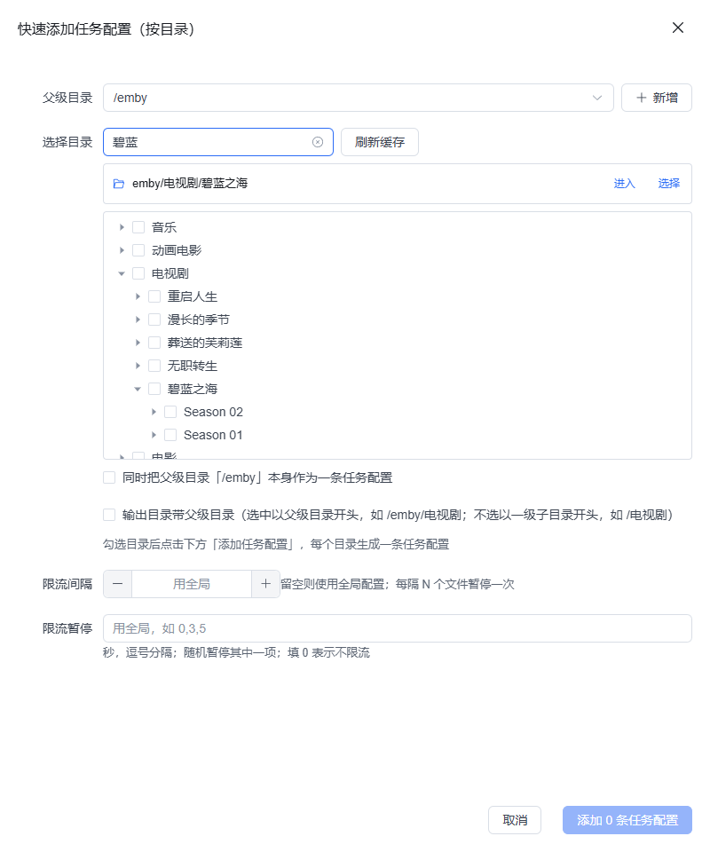

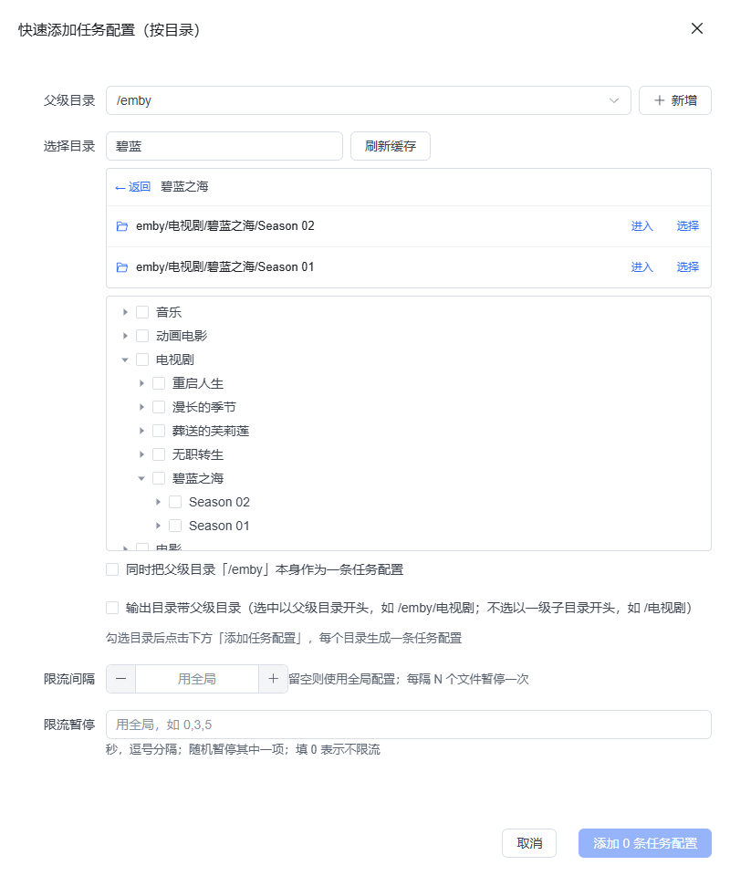

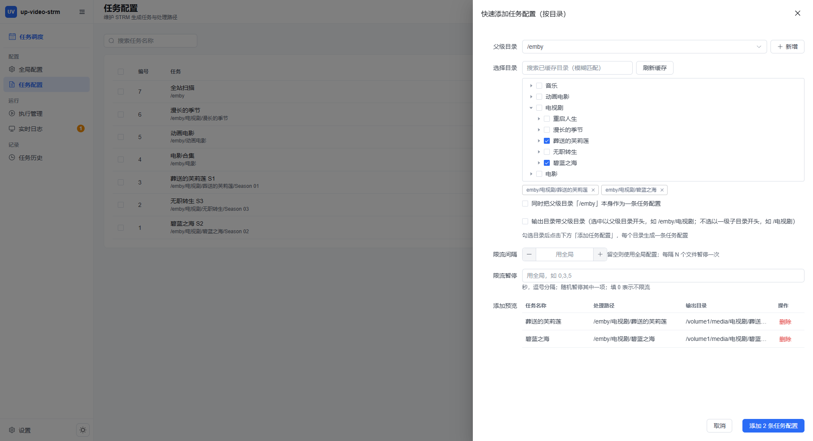

### 任务列表

- 工具栏左侧是关键字搜索；右侧依次是「新建任务」「快速添加」「批量删除」（无选中时批量删除不可用）。
- 表格把任务名与处理路径合并为「任务名主行 + 路径副行」；无任务时显示空状态与「新建任务」入口。
- 支持键盘输入关键字过滤与批量删除。

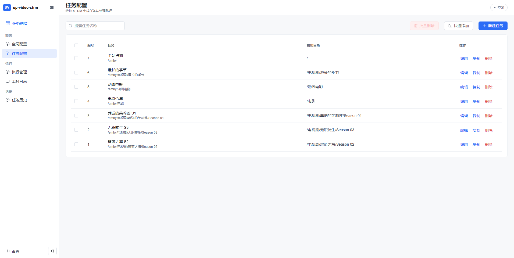

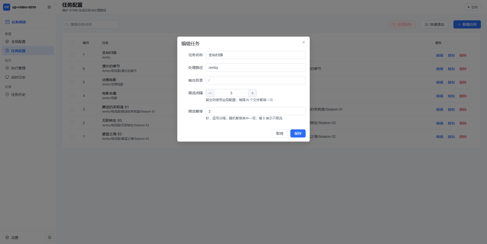

---

## 6. 执行管理

「执行管理」页面用于选择任务并发起一次扫描生成：左侧选任务，右侧设执行参数，底部操作条常驻。

### 操作步骤

1. 任务列表展示当前服务器的全部任务，可多选，也可用关键字过滤；正在运行的任务会置灰不可选。任务行内会显示该任务最近一次执行的视频数量。
2. 在右侧选择执行模式（见下表）。
3. 底部摘要显示「已选 N 个任务 · 共 M 个视频」；点击「执行任务」后自动跳转到「实时日志」。
4. 已启动的任务会出现在页面下方「正在执行」表格中，可「查看日志」或「取消」单个执行。

| 模式 | 说明 |
|------|------|
| 增量更新（默认） | 只处理本地缺失或云端已变化的文件，跳过未变化文件 |
| 全量生成 | 不比较本地状态，全部重新生成 |
| 仅更新 strm | 只生成 `.strm` 文件，不下载字幕 |

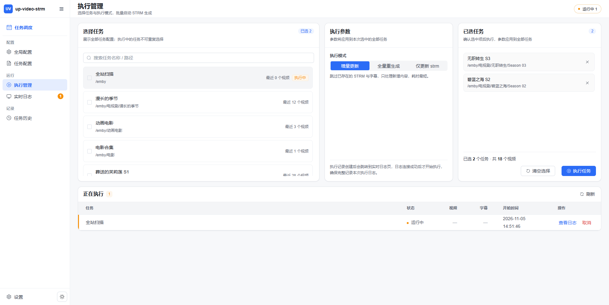

---

## 7. 实时日志

执行开始后自动跳转「实时日志」：

- 通过 WebSocket 实时推送日志，无需手动刷新。
- 页面分三段：顶部进度摘要（执行状态、连接状态、视频/字幕双进度与成功数、耗时）；中部终端日志（等宽字体、级别着色、行号、自动滚动开关）；底部工具条（级别过滤、关键字过滤、清屏、下载日志）。
- 多个任务同时执行时，可用顶部下拉框切换查看不同任务的日志；连接中断且执行未结束时，顶部会出现「重新连接」。
- 执行结束后日志完整保留，可到「任务历史」中回看或下载。

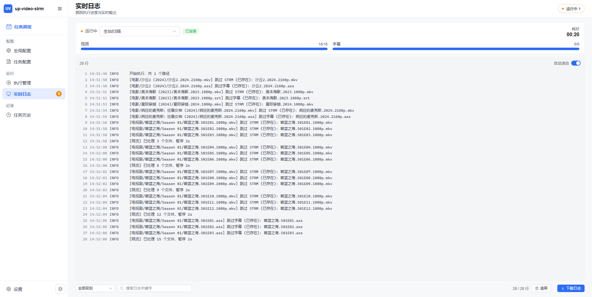

---

## 8. 任务历史

「任务历史」页面分两级：

- **列表**：展示每个任务最近一次执行情况（状态、时间、文件数、耗时等）；状态以彩色圆点 + 文字呈现，计数列右对齐，`0/0` 显示为 `—`。
- **详情**：点击「详情」进入独立页面（顶部有返回按钮），列出该任务的**全部**执行记录（每页 20 条），包含每次的执行选项、结果统计与日志。
- 详情中可「查看日志」（右侧抽屉展开）或「下载日志」（保存为日志文件）。

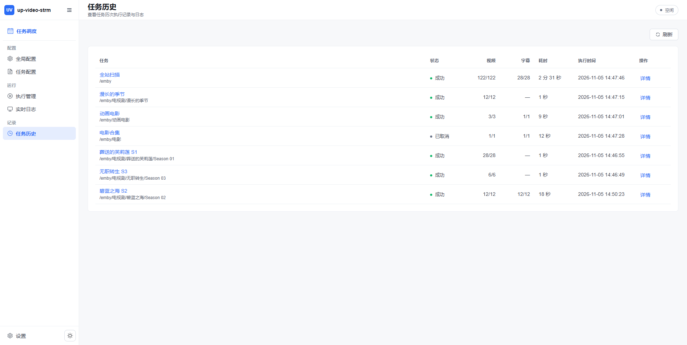

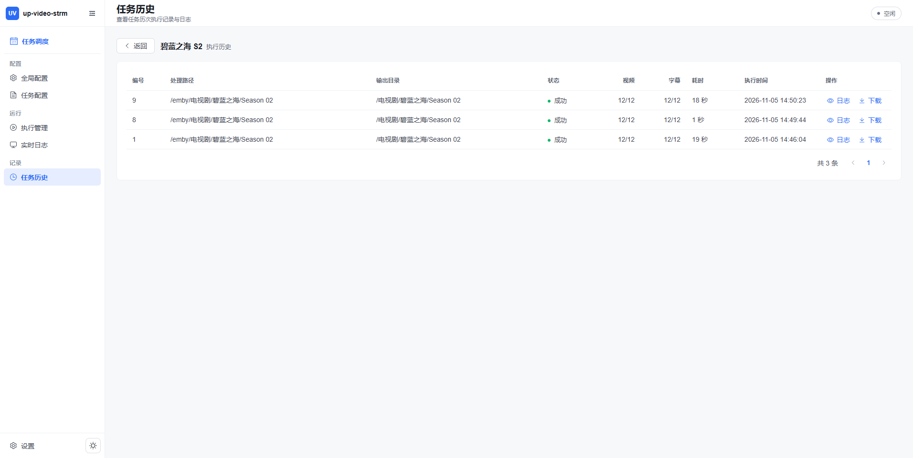

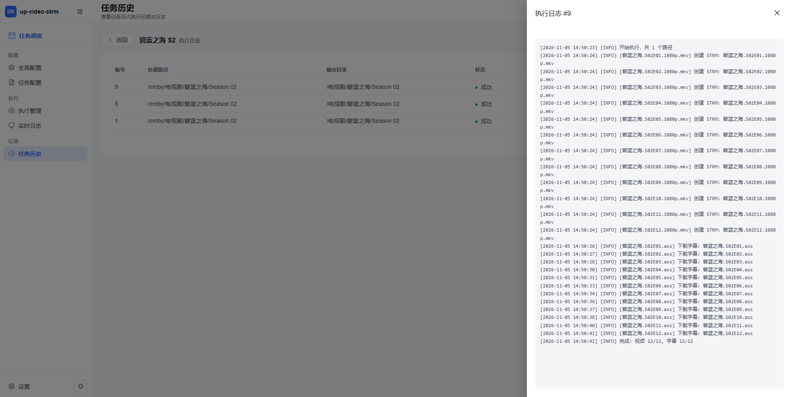

---

## 9. 界面主题

侧栏底部的主题按钮可在三种模式间切换：

- 浅色
- 深色
- 跟随系统（默认）

主题选择保存在本机，刷新或下次启动自动沿用，首屏无白屏闪烁。

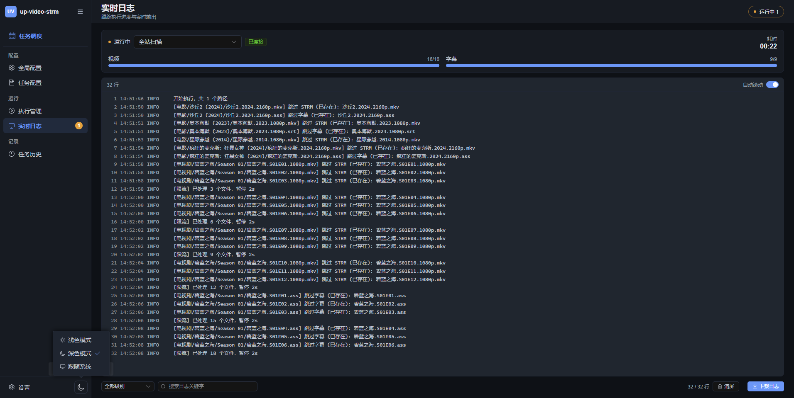

---

## 10. 桌面设置

点击侧栏底部「设置」进入独立设置页（页面标题由顶部标题栏统一展示）：

| 设置项 | 说明 |
|--------|------|
| 开机自动启动 | 写入当前用户注册表 `HKCU\...\CurrentVersion\Run`（值名 `up-video-strm`），卸载时清理；切换后立即生效 |
| 启动时最小化到托盘 | 开启后启动不显示窗口，直接进入托盘；**重启应用后生效** |
| 关闭窗口时最小化到托盘 | 关闭窗口时收进托盘而非退出；**立即生效** |
| 托盘图标显示 | 若托盘图标被 Windows 11 折叠，可一键跳转「任务栏设置」或「修复托盘图标」 |
| 打开数据目录 | 在资源管理器中打开 `%LOCALAPPDATA%\up-video-strm` |
| 数据与日志 | 跳转数据目录 / 查看日志路径 |
| 关于 | 显示当前版本与运行模式（桌面版 / 网页版） |

说明：

- 「托盘快捷设置」菜单与设置页共用同一份偏好，修改后两边同步。
- 不希望关闭窗口时收进托盘，可设置环境变量 `UP_VIDEO_STRM_TRAY=0`（此时关闭窗口即退出）。
- 设置项保存在数据目录的 `desktop.json`，与数据库分离，备份时可一并复制。

> 若通过源码以网页方式运行（非桌面版），设置页为只读展示，开机自启、数据目录等桌面能力不可用。

---

## 11. 升级与备份

### 升级

1. 先退出正在运行的旧版本（托盘菜单「退出」）。
2. 运行新版本安装包：若为向导升级，卸载旧版本时**不要**勾选删除数据（默认保留）。
3. 安装完成后启动新版本，确认服务器、任务、历史与已生成的输出文件仍在。

### 备份

先退出程序，再复制整个数据目录：

```powershell
# 备份到 D:\backup（路径按需修改）
Copy-Item "$env:LOCALAPPDATA\up-video-strm" -Destination "D:\backup\up-video-strm" -Recurse
```

必须包含的内容：

| 内容 | 说明 |
|------|------|
| `data\up_video_strm.db` | SQLite 数据库（服务器、任务、全局配置、执行历史） |
| `openlist_logs\` | 每次执行的日志文件 |
| `output\` | 生成的 `.strm` 与字幕（目录较大时可按需选择） |
| `desktop.json` | 桌面偏好（开机自启外的窗口行为） |
| `.env`（如有） | 自定义的应用配置 |

还原：退出程序 → 用备份覆盖数据目录 → 启动程序。

---

## 12. 旧版本数据兼容

从早期版本升级到当前版本时，程序会自动兼容既有数据，**无需手动迁移**：

| 项目 | 兼容行为 |
|------|----------|
| 数据目录 | 优先使用新目录 `%LOCALAPPDATA%\up-video-strm`；若新目录不存在、而旧目录 `%LOCALAPPDATA%\video-strm` 存在，则**原地沿用旧目录**并位于其下，不会复制或搬移文件 |
| 数据库文件 | 数据目录（或源码运行的 `data/`）中优先使用新库 `up_video_strm.db`；若新库不存在而旧库 `video_strm.db` 存在，则直接沿用旧库文件 |
| 环境变量 | 仅 `UP_VIDEO_STRM_HOME` 未设置时回退读取旧变量 `VIDEO_STRM_HOME`；旧版的 `VIDEO_STRM_HOST`、`VIDEO_STRM_PORT`、`VIDEO_STRM_UI`、`VIDEO_STRM_TRAY` 不再读取，请改用同名的 `UP_VIDEO_STRM_*` 变量 |
| 开机自启 | 桌面版启动后会把旧注册表自启值自动迁移为新值 `up-video-strm`；卸载时新旧两个值都会清理 |
| 主题偏好 | 主题保存在浏览器本地，存储键已变更，升级后若发现主题回到「跟随系统」，重新选择一次即可 |
| 单实例 | 互斥体与唤醒事件已改名，新版不识别仍在运行的旧版进程；升级时请先退出旧版本 |

> 升级前建议先按上一节备份数据目录；沿用旧目录的用户，其数据仍在 `%LOCALAPPDATA%\video-strm` 下，日志中的「数据目录」一行会显示实际使用的路径。

---

## 13. 常见问题

| 问题 | 处理方式 |
|------|----------|
| 保存服务器时提示目录校验失败 | 检查父级目录在云端是否存在、Token 是否有读写权限；确认无误仍失败可勾选「跳过目录校验」 |
| 「测试连通性」失败 | 按提示排查：地址需以 `http://`/`https://` 开头、端口可达、Token 正确（编辑时留空会复用已保存 Token）；服务器暂时不可达时可先勾选「跳过目录校验」保存，稍后补测 |
| 任务执行提示任务与服务器不匹配 | 系统只支持一台服务器，任务会自动绑定到当前服务器；若刚更换过服务器地址，请确认新地址的父级目录仍包含任务的处理路径 |
| 快速添加时看不到任何目录 | 该服务器还没有父级目录，先在服务器配置中添加；再点「刷新缓存」 |
| 搜索不到想要的目录 | 搜索范围仅限已缓存目录，需在目录树中逐层展开或点「刷新缓存」递归拉取 |
| 端口 8000 被占用怎么办 | 程序会自动顺延端口并在日志中打印实际地址；安装版窗口按实际端口加载，源码运行需同步修改前端代理配置 |
| 窗口打不开 / 白屏 | 检查 WebView2 运行时是否安装；查看 `logs\app.log`；也可用 `UP_VIDEO_STRM_UI=server` 启动后用浏览器排查 |
| 双击安装包被系统阻止 | 系统采用了 Smart App Control / WDAC 策略，需代码签名或在系统设置中处理；开发期可运行解压出的 `up-video-strm.exe` |
| 托盘图标找不到 | Windows 11 托盘折叠，拖到常驻区或在设置页点「修复托盘图标」 |

---

## 14. 数据目录与环境变量

### 数据目录

安装版的数据目录为 `%LOCALAPPDATA%\up-video-strm`（可用 `UP_VIDEO_STRM_HOME` 覆盖），程序启动后会切换到该目录，因此其中的相对路径都相对它解析：

| 子目录 / 文件 | 内容 |
|---------------|------|
| `data\up_video_strm.db` | SQLite 数据库 |
| `openlist_logs\` | 每次执行的日志文件 |
| `output\` | 默认输出根目录（`.strm` 与字幕） |
| `logs\app.log` | 应用启动与运行日志，超过 5 MB 轮转为 `app.log.1` |
| `webview\` | 内置窗口的本地存储（仅桌面版） |
| `desktop.json` | 桌面偏好设置（仅桌面版） |
| `.env`（可选） | 覆盖应用配置，见下文 |

源码运行时没有数据目录的概念，默认把数据库、日志、输出放在 `backend/` 下：`backend/data/`、`backend/openlist_logs/`、`backend/output/`。

### 启动器环境变量

以下变量在**启动前**由进程环境提供（不读取 `.env` 文件）：

| 变量 | 默认值 | 说明 |
|------|--------|------|
| `UP_VIDEO_STRM_HOME` | `%LOCALAPPDATA%\up-video-strm` | 数据根目录（数据库 / 日志 / 输出） |
| `UP_VIDEO_STRM_HOST` | `127.0.0.1` | 监听地址 |
| `UP_VIDEO_STRM_PORT` | `8000` | 首选端口，占用时自动顺延（最多 20 个） |
| `UP_VIDEO_STRM_UI` | 桌面版 `window`、源码 `server` | `window` 开原生窗口；`server` 只跑后台服务 |
| `UP_VIDEO_STRM_TRAY` | `1` | 关闭窗口是否收进托盘；`0` 表示关窗即退出 |

### 应用配置（.env，可选）

应用自身的配置也可通过 `.env` 覆盖，常用项：

| 变量 | 默认 | 说明 |
|------|------|------|
| `SQLITE_PATH` | `./data/up_video_strm.db` | SQLite 路径（桌面版相对数据目录） |
| `OPENLIST_LOG_DIR` | `./openlist_logs` | 执行日志目录 |
| `ALLOWED_ORIGINS` | 本机 `5173` 开发端口 | CORS 允许来源 |

安装版读取 `.env` 的顺序：先读数据目录下的 `.env`，再读 exe 同级的 `.env`（后者优先）；源码运行读取 `backend/.env`。更多后端配置与实现细节见 [docs/rules/backend.md](../docs/rules/backend.md)。
